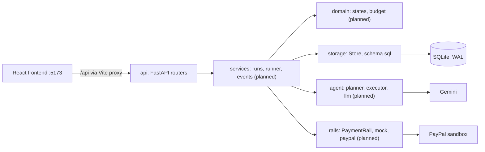

# Architecture

State as of milestone A0. Boxes marked *(planned)* are in the plan but not built.

## Layering

`api -> services -> domain / storage`. Routers stay thin. `domain/` is pure logic and never imports
an I/O library, so the budget rules can be tested without a database or network.

## Storage

One SQLite file in WAL mode behind `Store` (`backend/src/videre/storage/db.py`). All writes go
through `Store.transaction()`, which holds a single writer lock. From A1 each state change writes
its event row in that same transaction (an outbox), and subscribers are notified after commit.

The schema is `storage/schema.sql`, applied idempotently at startup. Every money column is integer
micro-USD. The phase B columns (`allocated_micro`, `spent_micro`, `reserved_micro`) exist from day
one so budgeting layers on without a migration.

## Configuration

`config.py` reads the environment and the repo-root `.env`. Secrets are `SecretStr`. Startup fails
if `RAIL=paypal` and the base URL is not the PayPal sandbox host.

## Data flow (target)

1. The user submits a prompt and a wallet amount; the backend creates a PayPal AUTHORIZE order.
2. After approval the planner produces a task tree; the runner executes tasks in dependency order.
3. Each call records tokens and a metered cost; events stream to the UI over SSE.
4. A task that cannot reserve its next step pauses until funded.
5. Close captures each task's spend (rounded up to the cent) and voids the remainder.
